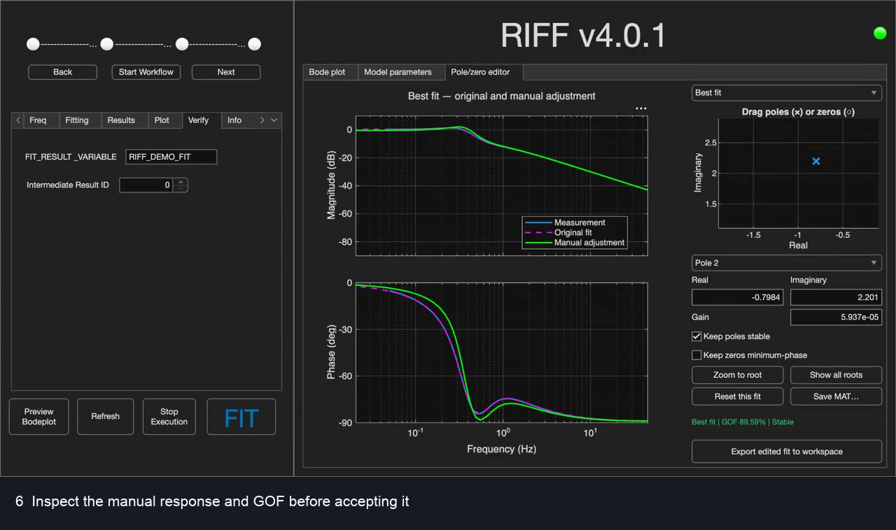
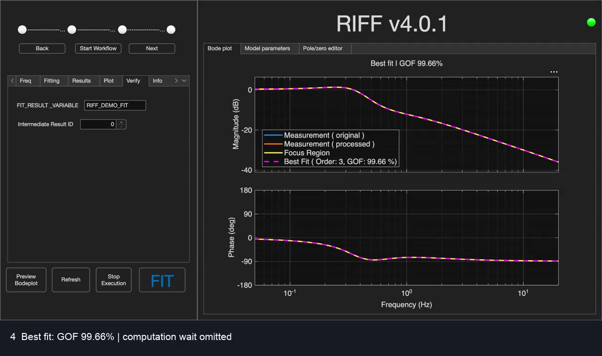
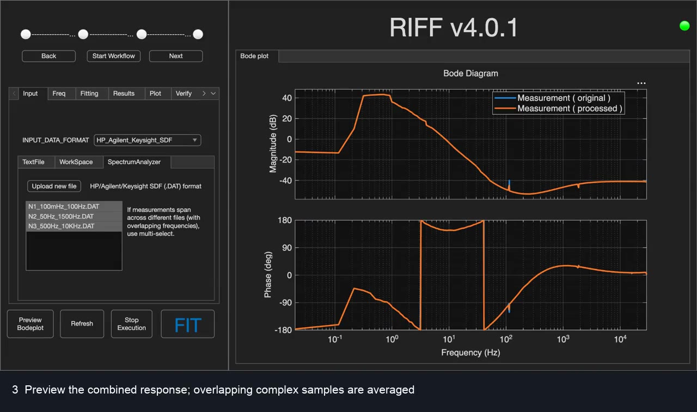

# RIFF v4.0.1: Robust IIR Fitting & Filtering

Fit measured transfer functions with robust IIR zero-pole-gain models. RIFF combines
instrument-data import, frequency weighting, model-order and algorithm selection,
and fit verification in a guided MATLAB app. The same fitting engine is available
from the command line through `fitTF.m`.

**v4.0.1 · MATLAB R2026b and newer.** Validated on R2026b.
[R2023b users: download the previous v3.0 release.](https://github.com/Nikhil-Mukund/RIFF/releases/tag/v3.0)

[Download the latest stable release](https://github.com/Nikhil-Mukund/RIFF/releases/latest)
· [Release notes](release_notes.md) · [Command-line API](#command-line-fitting)

## What's new

**v4.0.1 fixes joining measurements across frequency bands and replaces the old
large GIF tutorials with short current-app MP4 demos.** See [tutorials](#tutorials).
The v4.0 fitting and interactive plotting features remain available:

- **SysID AAA and N4SID-initialized `tfest` are enabled by default.** RIFF compares
  both candidates during optimization. AAA now uses System Identification Toolbox;
  RF Toolbox is optional. The legacy RF AAA backend remains an explicit choice.
- **Live Bode plots inside the app.** Zoom, pan, inspect data tips, and resize the
  app without generating an image of an external figure. The separate figure
  window is off by default and can be enabled when needed.
- **One shared core.** Fitting, native plotting, Verify, parameter formatting,
  and manual model refinement live inside `fitTF.m` for both app and script use.
- **Optional pole/zero refinement after fitting.** Drag roots or enter precise
  coordinates and gain, watch the response update, and reset each trial to its
  fitted original. This complements RIFF's automatic fitting workflow.
- **Reliable verification and export.** Model parameters follow the selected
  intermediate fit. Manual edits have separate exports and do not overwrite the
  optimizer's original results.

## Install and launch

1. Download **RIFF.mltbx** from the [latest release](https://github.com/Nikhil-Mukund/RIFF/releases/latest).
2. Open it in MATLAB R2026b or newer and complete installation. The package
   registers RIFF in the Apps gallery and puts `fitTF` on the MATLAB path.
3. Launch RIFF from the **Apps** tab or enter `RIFF` in the Command Window.

The package uses MATLAB's current `.mltbx` format. The older `.mlappinstall`
package remains available in the previous release for R2023b users.

Close existing RIFF windows when upgrading. Remove or disable older RIFF
installations that precede the new one on your path, then run `clear fitTF RIFF`.
Use `which RIFF -all` and `which fitTF -all` to check which installation runs.
If MATLAB reports an older package with the same ID, uninstall that older add-on
before installing the new version, or use its documented version-replacement option:

```matlab
mpminstall('RIFF.mltbx',AllowVersionReplacement=true);
```

Preserve custom INI files before replacing an installation. See
[MathWorks package installation](https://www.mathworks.com/help/matlab/ref/mpminstall.html).

RIFF reads and imports measurements into `measured_TFs` under MATLAB's **current
folder**, and saves results under the configured output folder. Choose a writable
working folder, then use the app's file-import controls to add your measurements.
Bundled examples are also included in the source download and installer.

### Required products

MATLAB R2026b+, Control System Toolbox, System Identification Toolbox,
Optimization Toolbox, Global Optimization Toolbox, Signal Processing Toolbox,
and Curve Fitting Toolbox cover the main app and fitting workflows.

Optional dependencies depend on the selected workflow:

- **RF Toolbox:** `rationalfit` or explicit `AAA_BACKEND='rf'` comparisons.
- **BADS:** the Bayesian Adaptive Direct Search optimizer; see
  [BADS](https://github.com/lacerbi/bads). RIFF's existing BADS path attempts to
  download it if unavailable.
- **LTPDA:** importing LTPDA Analysis Objects.

### Run from a source checkout

From the repository root:

```matlab
addpath(fullfile(pwd,'src'),'-begin');
clear fitTF RIFF
RIFF
```

Keep the original `src/utils` folder with `fitTF.m`. It contains instrument
import, configuration, and filtering utilities. All runtime helpers added in
this release are local or nested functions inside `fitTF.m`; the app supplies
its UI layout and callbacks. Build instructions are in [packaging](https://github.com/Nikhil-Mukund/RIFF/blob/v4.0.1/packaging/README.md).

## Fitting measurements

RIFF searches model order, fitting routine, frequency limits, and weighting to
maximize its goodness-of-fit score. Available estimators are:

| `ROUTINE` | Estimator | Default |
|---|---|---|
| 1 | RF vector fitting (`rationalfit`) | No |
| 2 | Transfer-function estimation (`tfest`, initialized with N4SID) | Yes |
| 3 | Complex frequency-response fitting (`invfreqs`) | No |
| 4 | Magnitude fitting (`fitmagfrd`) | No |
| 5 | Adaptive Antoulas–Anderson (`ssest`, SysID AAA) | Yes |

AAA estimates a continuous-time model using the selected frequency weights,
with no nonlinear refinement. The pole count is a maximum, not an exact order;
RIFF handles conjugate-pair overshoot. AAA does not independently constrain the
number of zeros. See the [MathWorks AAA guide](https://www.mathworks.com/help/ident/ug/estimate-siso-state-space-model-using-aaa-algorithm.html).

A [120-estimate comparison on five bundled sweeps](benchmarks/AAA_COMPARISON.md)
found that SysID AAA beat `tfest` on two sweeps and RF AAA on four under RIFF's
score. Neither algorithm always wins, which is why both SysID candidates remain
enabled. The report includes held-out scores, raw results, and limitations.

RIFF also supports smoothing, noise-floor estimation, damping sharp resonances,
stability constraints, minimum-phase models, input/output delay estimation, and
opt-in parameter covariance. Some options select a compatible estimator:

- Uncertainty estimation, explicit delay estimation, and allowing unstable
  models select `tfest`.
- Minimum-phase fitting selects `fitmagfrd`.
- Uncertainty estimation is **off by default** in both the app and command line.

### Input and output

Inputs include frequency/complex-response vectors, FRD models, text/CSV files,
HP/Agilent/Keysight SDF `.DAT` measurements, paired time series and sample rates,
and LTPDA Analysis Objects. File formats can specify Hz (`f`) or rad/s (`w`),
real/imaginary columns, or complex values; use `help fitTF` for the full syntax.

The returned `FIT` structure contains the ZPK model, measured and modeled
responses, GOF, intermediate fits, and optimization settings. Covariance fields
are populated when requested and supported. Saved fits can include MAT, FIG,
PNG, and LIGO FOTON-compatible second-order-section filter files.

## Combining measurements across frequency bands

For measurements of the **same system and response channel** taken over different
frequency ranges, select **HP_Agilent_Keysight_SDF** under Input. In the
**SpectrumAnalyzer** list, multi-select the SDF `.DAT` files, then use
**Preview Bodeplot** before fitting. Use the Freq tab to choose the fitting region.

The shared core sorts the bands, resamples onto a common Hz grid, and averages
complex responses where bands overlap. Different sampling rates, reversed file
order, nested ranges, and disjoint ranges are supported. Frequencies without
measurement coverage are omitted; no extrapolated samples are added. Duplicate
frequencies within a measurement are averaged, and nonpositive/nonfinite samples
are discarded. Keep calibration, channel, and units consistent across files;
RIFF does not align gain or phase offsets between separate measurements.

```matlab
files = fullfile('measured_TFs', ...
    ["N3_500Hz_10KHz.DAT","N1_100mHz_100Hz.DAT","N2_50Hz_1500Hz.DAT"]);
combined = fitTF('combine',files,1); % 1 Hz spacing + band endpoints; no figure
FIT = fitTF('F',combined.F,'TF',combined.TF);

% Or import, combine, and fit directly:
FIT = fitTF('SDF_DATASETS',files,'SDF_DATASET_FREQ_RESO',1);

% Other instruments: provide already-decoded frequency/response vectors.
bands(1) = struct('F',frequencyHz1,'TF',response1);
bands(2) = struct('F',frequencyHz2,'TF',response2);
combined = fitTF('combine',bands,0.25);
```

`combined.Coverage` gives the number of contributing measurements per output
frequency. `combined.Measurements` retains each normalized input. The existing
`combineTFs(files,dF,BO,plotToggle)` utility delegates to this core and keeps its
five-output interface. Its plot defaults to on; the new `fitTF('combine',...)`
command defaults to no plot. Overlap averaging can change fitted results compared
with older releases' fragile stitching behavior.

## Command-line fitting

```matlab
% Frequency in Hz; response is real + 1i*imaginary.
FIT = fitTF('F',frequencyHz,'TF',complexResponse); % tfest/N4SID + SysID AAA

% AAA only, without plots:
FIT = fitTF('F',frequencyHz,'TF',complexResponse, ...
    'ROUTINE',5,'PLOT_TOGGLE',0);

% Equivalent FRD and measurement-file inputs:
FIT = fitTF('FRD',frd(complexResponse,2*pi*frequencyHz),'ROUTINE',5);
FIT = fitTF('FNAME','measurement.csv','FORMAT','f,a,b','ROUTINE',5);

% Explicit comparison with the older RF backend (requires RF Toolbox):
FIT_RF = fitTF('F',frequencyHz,'TF',complexResponse, ...
    'ROUTINE',5,'AAA_BACKEND','rf');

defaults = fitTF('defaults'); % Same defaults as the app
```

`AAA_BACKEND='sysid'` is the default; `auto` is an alias for `sysid`. Failed AAA
candidates are penalized instead of replaced with a dummy model. Saved results
identify the selected routines, winning routine, and AAA backend. Nonconsecutive
routine selections such as `[2 5]` evaluate only those algorithms; `GUESS` and
saved optimization results retain their public numerical routine IDs.

Existing configuration files still apply when `READ_CONFIG` is enabled. Review
custom `ROUTINE` and `ESTIMATE_UNCERTAINITY` values when upgrading; explicit
settings can override the new defaults.

## Bode plots and verification

Previews and fitted responses are native interactive charts in the app. Hover
over the chart to access zoom, pan, data tips, and restoring the view. A scrollable
**Model parameters** tab shows roots, gain, and delay when `DISPLAY_ZPK` is enabled.

Use **Verify → Intermediate Result ID** to select a trial (`0` = best fit).
Both the plot and parameter display follow the selection. **Plot →
FIG_HANDLE_VISIBILITY** is off by default; enable it for an additional figure.
Saving still produces standalone FIG and PNG files. The existing time-domain
filtering workflow retains its image display.

```matlab
fitTF('verify',FIT,1); % Display trial 1 from the command line
parameters = fitTF('parameters',FIT.FRD_Model.modeled,'Best fit');
```

## Optional manual pole/zero refinement

After fitting, open **Pole/zero editor** to make small final adjustments:

- Drag a pole (×) or zero (○), or enter coordinates and gain numerically. The
  Bode response and GOF update immediately. Complex-conjugate roots move together,
  real roots remain real, and model delays are preserved.
- Use **Zoom to root** for clustered roots and **Show all roots** to reset the map.
- **Keep poles stable** and **Keep zeros minimum-phase** initially follow the
  app's fitting controls and constrain subsequent moves.
- Each best/intermediate fit has its own draft. **Reset this fit** restores only
  that selected model. Starting a new fit or preview clears the drafts.
- Export to a separate workspace variable or MAT file. Original results remain
  unchanged; old covariance and optimizer rankings are omitted from edited fits.

[](tutorials/demos/refinement.mp4)

*Watch the short demo: select trials, move a pole, adjust gain, and reset.*

The identical editor can be opened without launching the RIFF app:

```matlab
editor = fitTF('edit',FIT,'Interactive',true);
```

For scripts, use a session without graphics:

```matlab
editor = fitTF('edit',FIT);
editor.selectFit(1);                 % 0 = best, 1..N = intermediate trial
editor.moveRoot('pole',1,-0.6+2.5i); % Also accepts 'zero'
editor.setGain(3);
model = editor.getModel();
state = editor.getState();           % Selected trial, modified flag, GOF
FIT_manual = editor.exportFit();
editor.saveToFile('manual.mat');      % Saves variable FIT
editor.resetFit();
editor.close();
```

Command-line constraint options default to `'EnforceStability',true` and
`'EnforceMinimumPhase',false`; change them on creation or with
`editor.setConstraints(stable,minimumPhase)`. `editor.exportWorkspace()` creates
`RIFF_MANUAL_FIT`, adding a suffix when needed. Save the exported FIT structure
for reuse, rather than the live editor's callbacks and UI handles. This editor
adjusts fitted plant models; it does not perform closed-loop controller design.

## Validation and development

From the repository root on R2026b:

```matlab
results = run(testsuite('tests'));
assertSuccess(results);
```

Tests cover AAA through vectors/FRD/files, weighting, pole limits, routine
selection, uncertainty, embedded and standalone plots, trial verification,
mouse dragging, per-fit resets, exports, fresh-app startup, and multi-band
measurement joining through the app and command line. Isolated-copy
tests block the former helper files and GUI class to verify that `fitTF.m`
contains the new core functionality. The optional RF comparison test requires
RF Toolbox. See [release notes](release_notes.md) for the release validation.

The release build runs the suite before packaging. See [build instructions](https://github.com/Nikhil-Mukund/RIFF/blob/v4.0.1/packaging/README.md).

## Tutorials

Short, captioned recordings of **RIFF v4.0.1 on MATLAB R2026b**, captured at the
app's default window size. All three videos total **0.71 MB** (about 99% smaller
than the old GIF collection). Click a thumbnail to open its MP4. These scripted
walkthroughs use actual app controls and plots; computation waits are omitted.

| Fit and inspect | Join frequency bands | Verify and refine |
|---|---|---|
| [](tutorials/demos/fitting.mp4) | [](tutorials/demos/measurements.mp4) | [](tutorials/demos/refinement.mp4) |
| AAA + tfest, preview, embedded Bode plots | Select and join three bundled SDF bands | Trial parameters, pole dragging, gain, reset |

The fitting/refinement example uses a synthetic response; the joining example
uses the bundled SDF instrument files. See [demo details and reproduction](tutorials/README.md).
These compact videos replace the old GIFs in the current source and installer;
[archived tutorials remain in v3.0](https://github.com/Nikhil-Mukund/RIFF/tree/v3.0/tutorials).

## Background and acknowledgements

RIFF was developed for control and calibration filters at gravitational-wave
observatories, feedforward/feedback filters for seismic isolation, and removal
of linearly or bilinearly coupled noise. Related publication:
[N. Mukund et al., *Bilinear noise subtraction at the GEO 600 observatory*,
Phys. Rev. D 101, 102006 (2020)](https://doi.org/10.1103/PhysRevD.101.102006).

Acknowledgements: [Evgeny Pr's INI Config](https://www.mathworks.com/matlabcentral/fileexchange/24992-ini-config),
[Acerbi and Ma's BADS](https://arxiv.org/abs/1705.04405),
[LTPDA](https://www.lisamission.org/ltpda/), and
[Justin Dinale's SDF Importer](https://www.mathworks.com/matlabcentral/fileexchange/67513-sdf-importer).

Related tools: [Vectfit MATLAB](https://www.sintef.no/projectweb/vectfit/),
[Vectfit Python](https://github.com/PhilReinhold/vectfit_python),
[FDIDENT](https://www.mathworks.com/products/connections/product_detail/product_35570.html),
and [IIRrational](https://lee-mcculler.docs.ligo.org/iirrational/).

RIFF is released under the [GNU General Public License v3.0](LICENSE).
